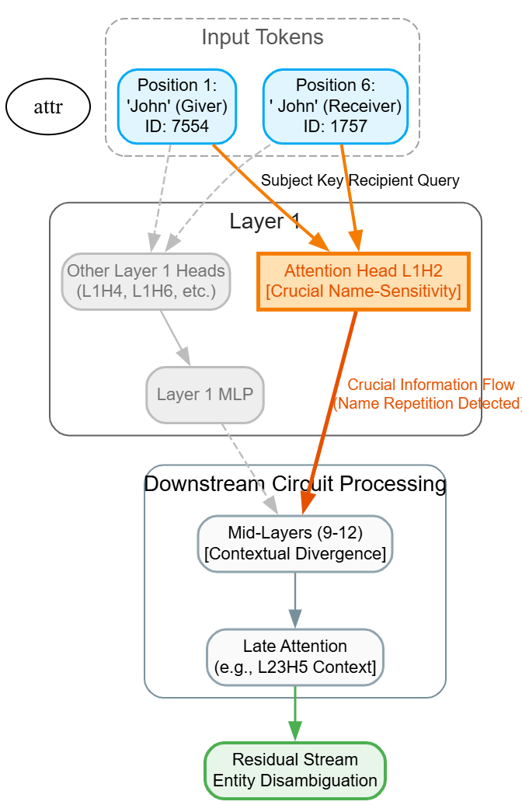
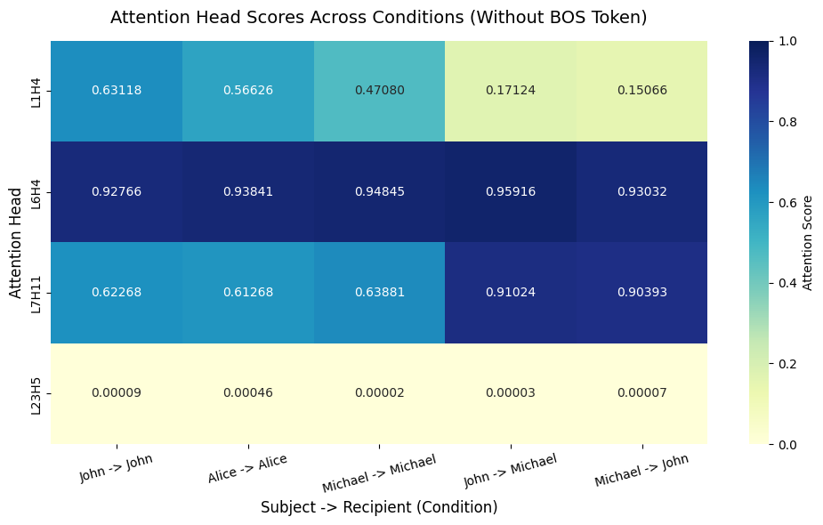

# Identical-Name Circuit Discovery in GPT-2 Medium

This repository contains the code and experimental configurations for investigating how transformer language models process identical lexical names that occupy different semantic roles. Using mechanistic interpretability, we explore whether the internal components of **GPT-2 Medium** merely detect lexical repetition or contribute to true entity disambiguation.

## 📌 Research Overview

The project uses the central example:  
> **"John gave a bag to John."**

While both tokens share a lexical identity, they occupy distinct semantic roles (John 1 as the Giver, John 2 as the Receiver). We investigate the internal computational circuits that emerge across transformer layers to distinguish or link these positions.

### Hypotheses
* **H1 — Contextual differentiation:** Representations of the identical names diverge across layers.
* **H2 — Repetition-sensitive attention:** Specific heads alter their behavior based on matching names.
* **H3 — Semantic role representation:** Components encode grammatical distinctions (Giver vs. Receiver).
* **H4 — Entity disambiguation:** Internal circuits actively differentiate real-world entities.

---

## 🧪 Key Findings

### 1. Residual Stream Analysis (Layer Cross-Section)
Measuring the cosine similarity between the two "John" token positions across the network reveals non-monotonic behavior across three clear phases:

* **Early Layers (0–9):** Similarity decreases progressively as unique context accumulates.
* **Middle Layers (9–12):** Similarity reaches its lowest measured point (**0.886895 at Layer 12**), marking maximal contextual distinction.
* **Later Layers (12–23):** Similarity increases again (**0.954089 at Layer 23**), returning to shared semantic or lexical properties.

### 2. Attention Head Discovery & Control Checks
We tracked the attention weights directed from the recipient position back to the subject position. Comparing the base sentence against controlled variants reveals distinct functional behaviors among key heads:

| Attention Head | Repeated Name (*John to John*) | Different Names (*John to Michael*) | Primary Behavior |
| :--- | :---: | :---: | :--- |
| **`L1H4`** | **0.41751** | 0.01892 | **Strong repeated-name sensitivity.** Allocates focus primarily between matching names. |
| **`L6H4`** | **0.37800** | 0.00090 | Tracks repetition alongside strong attention to the beginning token. |
| **`L7H11`** | **0.36752** | 0.00001 | Sharp binary switch response to repeated lexical context. |
| **`L23H5`** | **0.29085** | 0.26618 | Stable context integration; unaffected by name matching. |

---

| Attention Head | John → John | John → Michael | Michael → John |
| :--- | :---: | :---: | :---: |
| **`L1H4`** | 0.41751 | 0.01892 | 0.01076 |
| **`L6H4`** | 0.37800 | 0.00090 | 0.00277 |
| **`L7H11`** | 0.36752 | 0.00001 | 0.00000 |
| **`L23H5`** | 0.29085 | 0.26618 | 0.26483 |

**This specific experiment reveals that L1H4 is sensitive to the repeated-name condition.**

> Hence, L1H4 is the important component.

## Analyzing Attention Without the Preceding <|endoftext|> Token

Another concepts we can say Attention sink what happens when we don't consider the very first token across the distribution of the tokens.

## 🚀 Future Roadmap

The next phase of the project transitions from passive observation to causal verification:

* **Generalized Name Repetition:** Testing `L1H4` across alternative name templates (*Alice to Alice*, *Michael to Michael*) to ensure general repetition sensitivity.
* **Explicit Entity Separation:** Evaluating model behavior on sentences that explicitly separate entities (*"John gave a bag to another person named John"*).
* **Activation Patching:** Performing casual interventions on `L1H4` to confirm its structural necessity to the network's downstream processing.
* **Circuit Reconstruction:** Graphing the exact data flow between the discovered attention heads, MLP blocks, and the residual stream.
